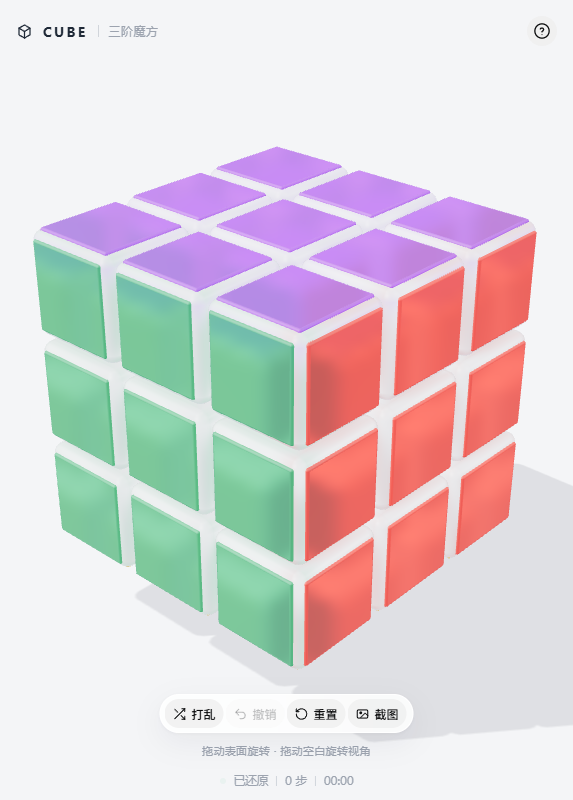
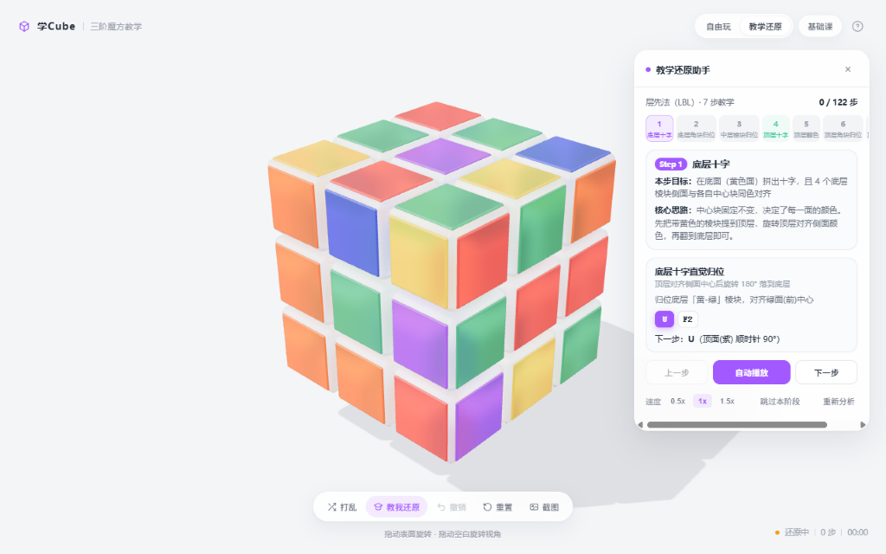
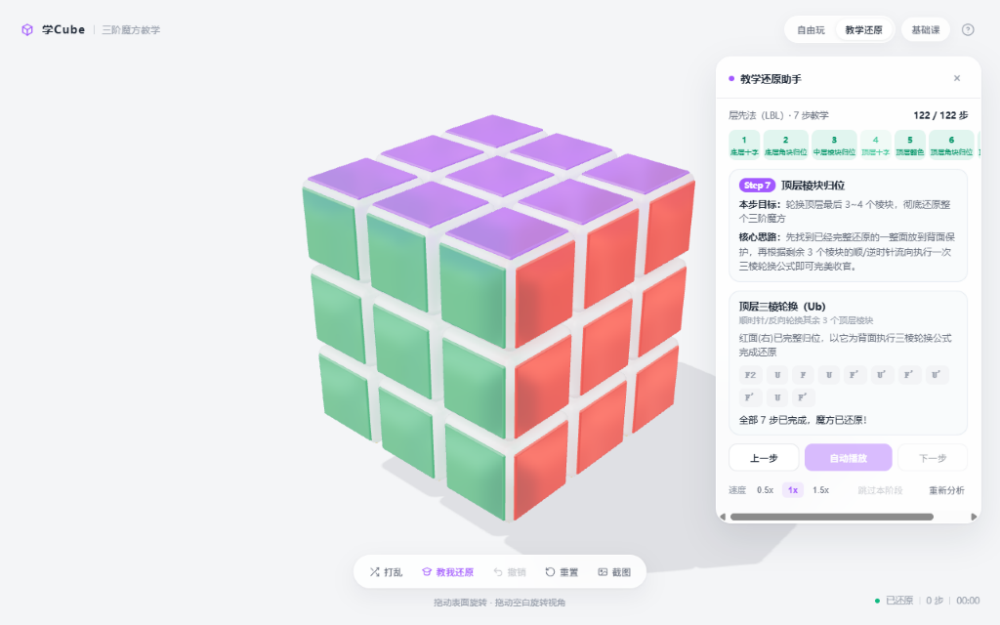

# 学Cube · 3D 有色磨砂玻璃魔方教学网站

> **How-to-Rubik** 是一个基于 **Three.js + TypeScript + Python** 构建的互动式 3D 三阶魔方教学网站。它以极简浅色影棚与**有色磨砂亚克力玻璃**魔方为视觉核心，结合 Python 教学求解引擎，为任意打乱状态实时生成**层先法（LBL）7 阶段**思路讲解与 3D 分步动画演示。

---

## 一、项目介绍

### 核心特性
- **有色磨砂玻璃 3D 魔方**：采用「不透明柔光内芯 + 物理透射（`MeshPhysicalMaterial` `transmission` / `ior: 1.49`）圆角玻璃外壳与彩玻面片」双层结构，搭配影棚环境贴图与柔光落地阴影，呈现出通透柔和的亚克力磨砂质感（顶面为 `#a259ff` 梦幻紫）。
- **Python 7 阶段层先法（LBL）教学引擎**：零第三方 Python 依赖，纯标准库实现。前端将 3D 魔方实时序列化为 54 字符标准 `URFDLB` 状态串，后端按 **底层十字 → 底层角块 → 中层棱块 → 顶层十字 → 顶层翻色（小鱼公式）→ 顶层角块归位 → 顶层棱块归位** 输出结构化教学剧本。
- **沉浸式 3D 分步播放器**：支持 **单步前进 / 回退、自动播放 / 暂停、0.5x~1.5x 倍速调节、跳过本阶段**，并实时高亮当前执行的标准公式字母。
- **零基础入门基础课**：内置块类型认知（中心块 / 棱块 / 角块）、国际标准记号图解及整体还原心法。

### 技术栈
- **前端**：Vite + TypeScript + Three.js（原生场景图与物理透射管线）
- **后端**：Python 3.10+（标准库 `http.server` 轻量 REST API）
- **测试**：Vitest（前端逻辑与序列化单元测试）+ Python `unittest`（200 组随机打乱求解校验）

---

## 二、环境配置与运行

### 1. 前置环境
- **Python**：`3.10` 或更高版本（无需安装额外 `pip` 包）
- **前端运行时**：[Bun](https://bun.sh/) 或 Node.js `18+`（含 `npm`）

### 2. 安装前端依赖
在项目根目录下执行：
```bash
# 使用 Bun（推荐）
bun install

# 或使用 npm
npm install
```

### 3. 启动项目（需同时启动后端与前端）

**启动 Python 教学求解服务**（默认监听 `127.0.0.1:8000`）：
```bash
python server/app.py
```

**新开一个终端，启动 Vite 前端开发服务器**（默认监听 `http://127.0.0.1:5173`）：
```bash
# 使用 Bun
bun run dev

# 或使用 npm
npm run dev
```
启动后在浏览器中打开 **http://127.0.0.1:5173** 即可开始使用（Vite 已配置 `/api` 代理自动转发至 Python 后端）。

### 4. 运行自动化测试与生产构建
```bash
# 前端单元测试（核心逻辑、材质池、54格序列化）
bun run test        # 或 npm run test

# Python 200 组随机打乱求解压力测试
python server/test_lbl_solver.py -v

# TypeScript 类型检查与生产打包
bun run build       # 或 npm run build
```

---

## 三、操作指南

### 1. 自由玩模式（3D 磨砂玻璃魔方）
打开网页后默认进入简洁的浅色影棚界面：
- **拧动魔方**：鼠标左键（或单指）按住魔方表面并向目标方向拖动，即可平滑拧动对应层 90°，松手自动吸附归正。
- **旋转视角**：在魔方之外的空白区域拖动，可 360° 自由旋转观察魔方；滚轮可缩放视距。
- **底部工具栏**：提供 **打乱**（20 步随机动画）、**教我还原**、**撤销**、**重置** 与 **截图**（一键导出当前高清 PNG）。



### 2. 教学还原模式（7 步层先法分步指导）
1. 点击底部工具栏的 **「打乱」**，或自己动手拧乱魔方。
2. 点击 **「教我还原」**（或右上角切换至 **「教学还原」**），右侧会滑出 **教学还原助手**，自动调用 Python 求解服务生成针对当前打乱状态的完整 7 阶段教程：
   - **7 阶段路线图**：直观展示当前所处阶段及已完成阶段。
   - **本步目标与核心思路**：解释“为什么这么拧”，而非死记硬背。
   - **公式步骤高亮**：当前执行步紫色高亮，下方附带中文方向提示（如 `U（顶面(紫) 顺时针 90°）`）。
   - **播放控制**：可随时点击 **「上一步」**、**「下一步」** 逐帧跟练，或使用 **「自动播放」** 与 **0.5x / 1x / 1.5x** 倍速观看完整演示，也可点击 **「跳过本阶段」** 直接进入下一阶段。



当全部 7 个阶段执行完毕后，右下角状态会自动切换为 **「已还原」**：



### 3. 快捷键与基础课
- 点击右上角 **「基础课」** 可随时查看魔方三种块结构、`U/D/L/R/F/B` 记号含义与层先法心法。
- 点击右上角 **`?`** 可查看操作帮助；键盘支持快捷拧动：

| 按键 | 功能 |
|---|---|
| `U` / `D` | 顶层（紫） / 底层（黄）顺时针旋转 90° |
| `F` / `B` | 前层（绿） / 后层（蓝）顺时针旋转 90° |
| `R` / `L` | 右层（红） / 左层（橙）顺时针旋转 90° |
| `Shift` + 上述字母 | 对应层**逆时针**旋转 90° |
| `Z` | 撤销上一步 |
| `Esc` | 关闭当前弹窗 |
